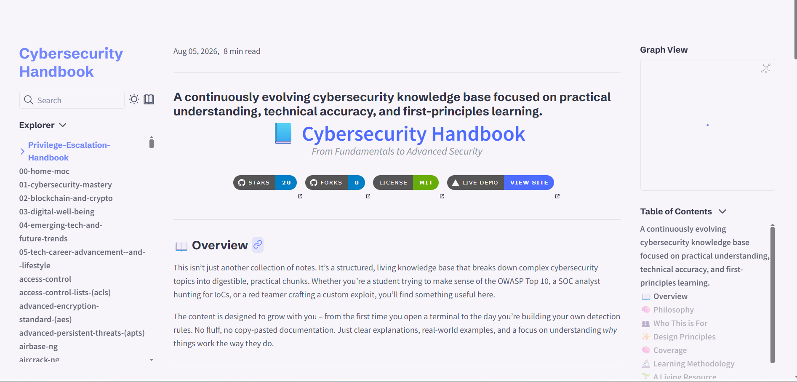
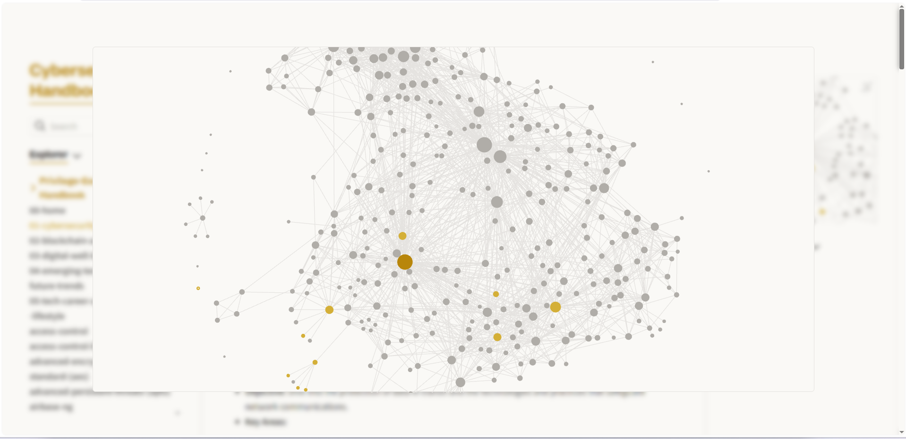
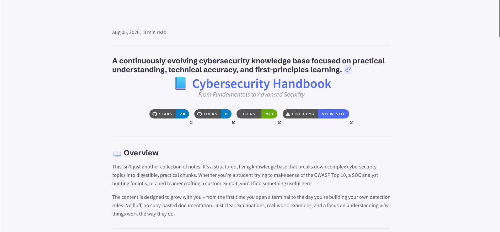
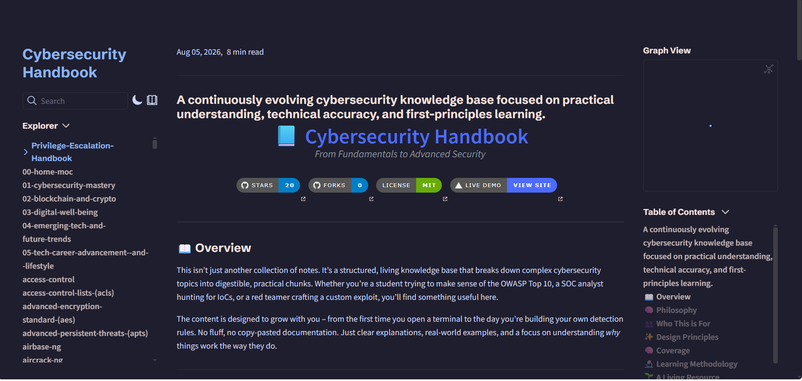
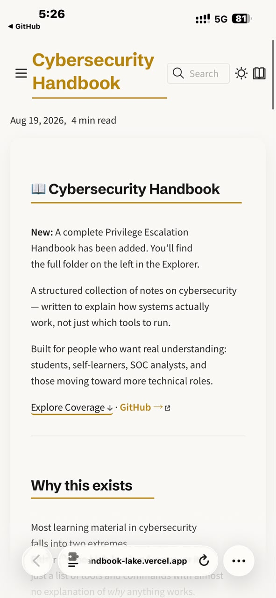
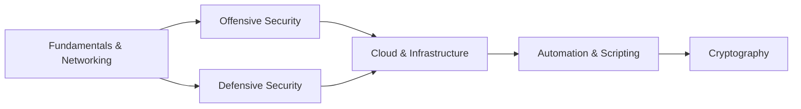

<div align="center">


<a href="https://cybersecurity-handbook-lake.vercel.app">
  
</a>

</div>

<h1 align="center">📚 Cybersecurity Handbook</h1>

<p align="center">
  An open-source cybersecurity knowledge base for students, professionals, and
  self-learners — built as structured notes, hands-on labs, and real-world
  concepts you can search and navigate visually.
</p>

<p align="center">
  Built with <b>Quartz</b> • Powered by <b>Markdown</b> • Community Driven • MIT Licensed
</p>

<p align="center">
  <a href="https://cybersecurity-handbook-lake.vercel.app">
    
  </a>
  <a href="#quick-start">
    
  </a>
  <a href="#contributing">
    
  </a>
</p>

<p align="center">
  
  
  
</p>

<p align="center">
  
  
  
  
  
  
  
</p>

<p align="center">
  
  
  
  
  
  
  
</p>


<blockquote align="center">
  <b>Learn cybersecurity with clarity — from fundamentals to advanced concepts, in one searchable, open-source handbook.</b>
</blockquote>

<div align="center">

<table>
<tr>
<th>📝 Notes</th>
<th>🧪 Labs</th>
<th>🔍 Search</th>
<th>⚡ Performance</th>
<th>👥 Community</th>
</tr>
<tr>
<td align="center">400+ and growing</td>
<td align="center">Hands-on learning</td>
<td align="center">Instant, full-text</td>
<td align="center">Powered by Quartz</td>
<td align="center">Open source</td>
</tr>
</table>

</div>


<details>
<summary><b>📑 Table of Contents</b></summary>
<br>

- [Preview](#preview)
- [Why I built this](#why-i-built-this)
- [What you get](#what-you-get)
- [Quick start](#quick-start)
- [What's covered](#whats-covered)
- [Contributing](#contributing)
- [Support this project](#support-this-project)
- [License](#license)

</details>

---

## Preview

<p align="center">
  
  
</p>
<p align="center"><sub>Homepage &nbsp;&nbsp;·&nbsp;&nbsp; Interactive knowledge graph — every note links to related concepts</sub></p>

<p align="center">
  
  
</p>
<p align="center"><sub>Reader mode &nbsp;&nbsp;·&nbsp;&nbsp; Dark mode (Catppuccin Mocha)</sub></p>

<p align="center">
  
</p>
<p align="center"><sub>Fully responsive on mobile</sub></p>


## Why I built this

I've spent a lot of nights doing exactly what you're probably doing right now — reading forums, watching tutorials, trying to piece together what actually matters in security.

Most of what I found fell into one of three buckets: too shallow (a list of tools with no explanation of why they work), too scattered (good content spread across a dozen blogs and paid courses), or priced like a $500 course was the only way in.

So I started writing my own notes — the kind that explain *how things work*, not just which commands to paste. Over time, those notes grew into this handbook.

I don't have all the answers, but I do think this stuff is learnable when it's explained clearly. If this saves you one late-night rabbit hole, it did its job.

<div align="right"><a href="#cybersecurity-handbook">⬆ back to top</a></div>

## What you get

- 🔍 **Instant search** across 400+ notes
- 🕸️ **Interactive graph** — see how topics connect
- 🌗 **Light & dark mode**, including Catppuccin Mocha
- 📱 **Works on any device** — phone, tablet, or laptop
- 🎯 **First-principles explanations**, not just command lists
- 🚫 No ads, no paywalls, no login required


## Quick start

Get it running locally in under 2 minutes.

**Prerequisites:** Node.js v18+ and npm or yarn.

<details>
<summary><b>🐧 Linux / macOS</b></summary>

```bash
git clone https://github.com/priyanshu-rawa/Cybersecurity-Handbook.git
cd Cybersecurity-Handbook
npm install
npm run quartz:dev
```

</details>

<details>
<summary><b>🪟 Windows (PowerShell)</b></summary>

```powershell
git clone https://github.com/priyanshu-rawa/Cybersecurity-Handbook.git
cd Cybersecurity-Handbook
npm install
npm run quartz:dev
```

</details>

**Build for production:**

```bash
npm run quartz:build   # build the static site
npm run quartz:serve   # preview the build locally
```

---

## What's covered

| Area | Topics |
|---|---|
| 🖥️ Operating systems & networking | Linux, Windows, TCP/IP, DNS, VPNs, firewalls |
| ⚔️ Offensive security | OWASP Top 10, SQL injection, XSS, scanning, exploitation, post-exploitation |
| 🛡️ Defensive security | SOC, incident response, SIEM, log analysis, threat hunting, digital forensics |
| ☁️ Cloud & infrastructure | AWS, Azure, GCP, Zero Trust, Docker, Kubernetes, DevSecOps, IAM |
| 💻 Programming & automation | Python, Bash, PowerShell, scripting, CI/CD, Git |
| 🔐 Cryptography | Symmetric/asymmetric encryption, AES, RSA, hashing (SHA-256, MD5), PKI, TLS, certificates |

A rough learning path, if you're starting from zero:




## Contributing

Contributions of all sizes are welcome, from fixing a typo to adding a whole new topic. First time contributing to open source? Happy to walk you through it, just open an issue.

**Ways to help:**

- 📝 Content — new topics, corrections, clearer explanations
- 🎨 Design — diagrams, layout, visual polish
- 💻 Code — bug fixes, Quartz config, new features
- 📚 Docs — formatting, cross-references, clarity
- 👥 Community — reporting issues, answering questions

**Steps:**

| Step | Action |
|:---:|---|
| 1 | Fork the repo (button top right) |
| 2 | Clone your fork: `git clone https://github.com/your-username/Cybersecurity-Handbook.git` |
| 3 | Create a branch: `git checkout -b feature/your-feature-name` |
| 4 | Make your changes |
| 5 | Stage them: `git add .` |
| 6 | Commit: `git commit -m "Add: new section on ransomware defense"` |
| 7 | Push: `git push origin feature/your-feature-name` |
| 8 | Open a Pull Request against `main` |

**Where things go:**

| Type | Location |
|---|---|
| 📝 Notes | `content/` (relevant category folder) |
| 🧪 Labs | `content/` (relevant lab folder) |
| 🖼️ Images | `assets/images/` |
| 📊 Diagrams | `assets/diagrams/` |

<div align="right"><a href="#cybersecurity-handbook">⬆ back to top</a></div>

## Support this project

This handbook is free and always will be. If it's helped you, here's what actually makes a difference:

| | |
|---|---|
| ⭐ Star the repo | Helps other people find it |
| 📢 Share it | LinkedIn, X, Reddit, Discord — wherever your network is |
| 🖊️ Contribute | Fix a typo, add a topic, sharpen an explanation |
| 💬 Give feedback | Open an issue or a discussion |
| 🐛 Report bugs | Tells me what's broken or unclear |

Want to share it? Feel free to copy this:

> *"Found this free Cybersecurity Handbook with 400+ notes, built with Obsidian + Quartz: https://github.com/priyanshu-rawa/Cybersecurity-Handbook"*

If this handbook made a difference for you, a quick note is genuinely appreciated: `zero.trace0654@proton.me`

<div align="center">

**Star History**

<a href="https://star-history.com/#priyanshu-rawa/Cybersecurity-Handbook&Date">
  
</a>

</div>


## License

MIT License — see [LICENSE](LICENSE.txt) for details. Use, modify, distribute, or commercialize freely, as long as the copyright notice stays intact. Contributions back are always welcome.


<div align="center">

**Cybersecurity Handbook** — a knowledge base built through documentation, experimentation, and practical learning.

*If this helped you, a star keeps me motivated to keep building.* ⭐
Also check out CyberTimeline — 35 real cyberattacks across five decades, in an interactive timeline.

</div>

</div>
